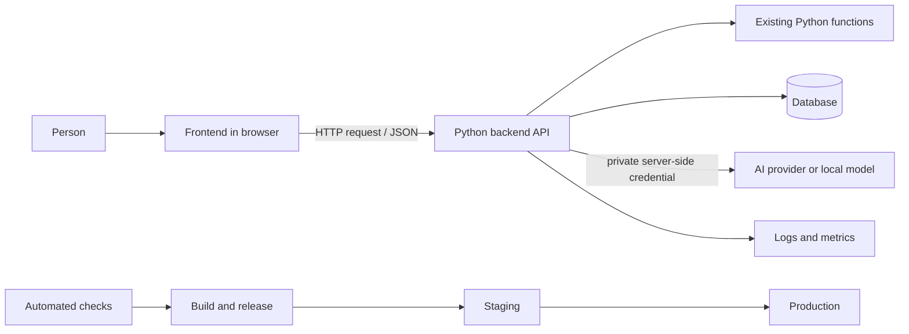

# Build and Ship: Hands-on Learning Path

## The goal

Build one small, working product: an **AI Lab Dashboard**. A user can estimate model-weight memory, run a small benchmark, view previous runs, and optionally ask an AI service to explain a result in plain language.

The point is to turn concepts into a product you can run and demonstrate. Do one small activity at a time. Read or watch only the section needed for that activity, build it, run it, and explain what happened in your own words.

The repository currently has Python command-line tools and a comparison notebook. The web interface, web API, and database described below are future learning steps.

## How a production app fits together

The frontend handles the screen and user input. The backend validates requests, runs calculations, accesses the database, and calls AI services. The database stores durable records. Configuration supplies environment-specific values. Tests and automated checks reduce the chance of shipping errors. Deployment makes a chosen version available to users.

## Work loop for every activity

1. State the behavior you want in one sentence.
2. Build the smallest version that demonstrates it.
3. Run it yourself and try one normal input and one invalid input.
4. Add or update a test for the behavior.
5. Read the error or log when something fails; fix the cause, not just the symptom.
6. Explain the code path from input to output. Add new terms to `AGENTS.md`.
7. Review the diff and save a small Git commit when the work is ready.

## Stage 1: Make the current tools easy to run

**Learn:** project setup, packages, command-line tools, and clear error messages.

**Build:** complete the README and setup instructions. Add simple Makefile commands such as `make setup`, `make check`, and `make test`. Make sure a new user can create a virtual environment, install the project, and run the existing environment check and model-size estimate.

**Practice:**

- Follow the setup instructions from a clean terminal.
- Run `python -m ailab.check_env`.
- Run `python -m ailab.model_size 7000000000 fp16` and compare the result with the hand calculation in the glossary.
- Change one input to an invalid value and explain the error.

**Done when:** a person who has not worked on the repository can follow the README and run both commands.

**Read:** [Packaging Python Projects](https://packaging.python.org/en/latest/tutorials/packaging-projects/) explains the `src/` layout and `pyproject.toml`.

## Stage 2: Build a simple frontend

**Learn:** HTML structures a page, CSS styles it, and JavaScript responds to user actions.

**Build:** create a page with a parameter-count field, precision selector, “Estimate” button, and result area. At first, calculate the estimate in browser JavaScript or use a temporary fixed example. Do not add a frontend framework yet; learn the browser basics first.

**Practice:**

- Show a helpful message for empty, negative, or non-number input.
- Make the page usable with a keyboard and at a narrow phone width.
- Sketch the page before coding. A sketch of the screen is a **wireframe**.
- Write one **user story**, such as “As a learner, I want to enter a parameter count and see an estimate so I can judge model size.” Define **acceptance criteria** that say exactly what counts as done.

**Done when:** the page works in a browser and invalid input produces a clear message.

**Read:** [MDN: Your first website](https://developer.mozilla.org/en-US/docs/Learn_web_development/Getting_started/Your_first_website) walks through structure, styling, interactivity, and publishing. [MDN Core learning modules](https://developer.mozilla.org/en-US/docs/Learn_web_development/Core) provides a broader HTML, CSS, and JavaScript sequence.

**Watch:** [Web Development with HTML & CSS — freeCodeCamp](https://www.youtube.com/watch?v=dX8396ZmSPk) is a practical video companion. Build the small estimator screen as you learn instead of copying the entire course project.

## Stage 3: Connect the frontend to a Python backend

**Learn:** a browser is a client. It sends an HTTP request to a backend API; the backend returns a response, commonly JSON. An API endpoint is one address and operation, such as `POST /estimates`.

**Build:** add a small FastAPI backend. Create:

- `GET /health` to report that the service is running.
- `POST /estimates` to validate the count and precision, call the existing `estimate_memory_gb()` function, and return the result.
- A frontend `fetch()` call that sends the form values and displays the backend response.

Keep calculations in reusable Python functions. Keep HTTP-specific work in the API layer. Keep API keys out of browser JavaScript: anything sent to a browser can be inspected by its user.

**Practice:** send a valid request, a negative count, an unsupported format, and malformed JSON. Learn to distinguish a successful response from client errors and server errors.

**Done when:** entering values in the browser calls Python and displays the actual result from `model_size.py`.

**Read:** [FastAPI first steps](https://fastapi.tiangolo.com/tutorial/first-steps/) introduces endpoints. [FastAPI request bodies](https://fastapi.tiangolo.com/tutorial/body/) explains accepting and validating JSON input.

**Watch:** [Python API Development — freeCodeCamp](https://www.youtube.com/watch?v=0sOvCWFmrtA) builds a FastAPI service. It is an older course, so use current FastAPI documentation if commands or syntax differ.

## Stage 4: Store benchmark history and learn migrations

**Learn:** a database stores information beyond one process run. A schema describes its tables and columns. A migration is a versioned change to that schema or its data.

**Build:** start with SQLite for local learning. Store each benchmark run in a `benchmark_runs` table with fields such as ID, environment, matrix size, data type, seed, average duration, and creation time. Add `POST /benchmarks` to save a run and `GET /benchmarks` to list runs.

Use SQLAlchemy to connect Python objects and SQL tables, and Alembic to manage migrations. Create an initial migration for the table. Then create a second migration that adds a field such as `fastest_seconds`.

**Practice:**

- Create a fresh database by applying all migrations.
- Insert and list benchmark records.
- Apply the second migration to a database that already has records; confirm the old records remain usable.
- Test the migration on a disposable database before applying it to important data.

**Done when:** benchmark history persists after restarting the app, and a migration upgrades an existing database without losing its records.

**Read:** [PostgreSQL Tutorial](https://www.postgresql.org/docs/current/tutorial.html) teaches tables, queries, joins, and transactions. [SQLAlchemy Unified Tutorial](https://docs.sqlalchemy.org/en/20/tutorial/) teaches Python/database connections and ORM use. [Alembic Tutorial](https://alembic.sqlalchemy.org/en/latest/tutorial.html) walks through creating and applying versioned migrations.

**Watch:** [PostgreSQL Tutorial for Beginners — freeCodeCamp](https://www.freedevcourses.com/course/postgresql-tutorial-beginners) links to a beginner video course on SQL queries. Use it to practice SQL; use Alembic’s documentation for the Python migration workflow.

## Stage 5: Add an AI feature safely

**Learn:** an AI feature is application logic around a model: input validation, a model call, output handling, failure handling, and evaluation. The model API call belongs in the backend so credentials stay private.

**Build:** add an optional “Explain this result” action. The backend sends a short summary of a benchmark result to a model and returns a plain-language explanation. Keep the model name and limits configurable. Set request timeouts and spending limits. Do not send API keys, private prompts, or unrelated user data to the model.

**Practice:**

- Test a normal result, empty result, model timeout, invalid API key, and provider error.
- Create a small fixed set of benchmark summaries and check that explanations mention the measured values and do not claim the benchmark used a GPU when it did not.
- Record response time and provider/model name; review usage cost before increasing traffic.

**Done when:** the AI feature explains data the application actually measured, fails clearly when the provider is unavailable, and does not expose its credential to the browser.

**Read:** [Hugging Face Course: Introduction](https://huggingface.co/docs/course/chapter1/1) introduces language models and the tools around them. Use your chosen model provider’s official API guide when you implement the actual provider connection.

## Stage 6: Test the connected application

**Learn:** a unit test checks one small function; an integration test checks connected pieces; an end-to-end test checks a complete user path.

**Build:** write tests for memory calculations, API input validation, saving and retrieving benchmark runs, and the frontend’s success/error states. Replace the external AI service with a controlled fake in most automated tests; this keeps tests predictable and avoids spending money on every test run.

**Practice:** break one expected behavior on purpose and observe which test catches it. Then restore the behavior and run the full test suite.

**Done when:** the most important user flows have automatic checks and failures tell you which behavior broke.

**Read:** [pytest Getting Started](https://docs.pytest.org/en/stable/getting-started.html) demonstrates writing and running Python tests.

## Stage 7: Package and deploy a rehearsal version

**Learn:** a container packages an app with its runtime dependencies. Deployment runs a chosen build in an environment users can reach. Staging is a rehearsal environment before production.

**Build:** use Docker to package the backend and Docker Compose to run the app with its database locally. Store persistent database files in a volume, and pass secrets at runtime rather than baking them into the image. Add a staging deployment only after local behavior is repeatable.

**Practice:** build the container from a clean state, start it, call `/health`, create a benchmark record, restart the app, and confirm the record remains. Test a database migration in staging before production.

**Done when:** another person can start the app from documented commands and data survives a container restart.

**Read:** [Docker 101](https://www.docker.com/101-tutorial/) is a hands-on path for images, containers, volumes, and Compose. [FastAPI deployment concepts](https://fastapi.tiangolo.com/deployment/concepts/) explains HTTPS, process restarts, memory, multiple workers, and pre-start steps such as migrations.

**Watch:** [Getting Started with Docker — Docker](https://www.youtube.com/watch?v=gAGEar5HQoU) is a hands-on workshop covering containers, dependencies, volumes, Compose, and deployment.

## Stage 8: Automate checks and operate the product

**Learn:** continuous integration (CI) runs checks automatically when code changes. Monitoring and logs help you understand a running service. Rollback returns an application to a previous release if a new one fails.

**Build:** create a GitHub Actions workflow that installs dependencies and runs tests on each proposed change. Add useful logs, a health check, request size and matrix-size limits, and a documented backup/restore process. Record the Git revision and timestamp with benchmark results so you know which code produced them.

**Practice:** make a change that causes a test to fail and see CI catch it. Deploy a harmless change to staging, inspect logs, and practice the documented rollback steps.

**Done when:** a change is checked automatically, a failed service can be diagnosed, and you have a tested way to recover application code and database data.

**Read:** [GitHub Actions: Building and testing Python](https://docs.github.com/en/actions/tutorials/build-and-test-code/python) shows a Python CI workflow.

## A practical order for this repository

1. Follow the README/setup commands and review the tests that cover the current tools.
2. Run and understand the existing command-line tools and benchmark report.
3. Build the small browser estimator.
4. Add a FastAPI backend that calls the existing Python functions.
5. Save benchmark history with SQLite and versioned migrations.
6. Add the optional AI explanation with server-side credentials and evaluations.
7. Add integration tests, CI, a Docker setup, and a staging deployment.

Keep the first version deliberately small. A finished flow that a second person can run, understand, and repeat teaches more than a large pile of half-built features.
